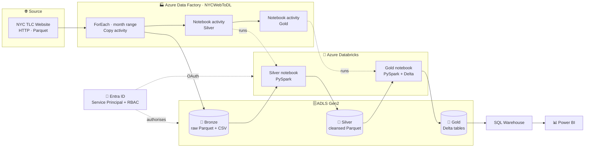

# 🚕 NYC Taxi Trips: End-to-End Azure Lakehouse Platform

### From a public web source to an executive dashboard, fully orchestrated, secured and governed.


---

## 🎯 Project Summary

NYC's Taxi & Limousine Commission publishes millions of trip records every month as raw files. This project turns that raw feed into a **trusted analytics product**:

1. 🚚 **Ingest** monthly Parquet files from the public website into my own data lake using a parameterised ADF pipeline
2. 🧹 **Refine** the data through a Bronze → Silver → Gold medallion architecture on Databricks
3. 🔺 **Persist** the curated layer as governed **Delta tables** in Unity Catalog
4. 📊 **Serve** a star-schema model to Power BI for revenue, trip and borough analytics
5. 🤖 **Orchestrate** the whole flow, ingestion through transformation, from a single Azure Data Factory pipeline

### 📂 Data sources

| Dataset | Format | Role | Loaded by |
|---|---|---|---|
| Green Taxi trips `green_tripdata_YYYY-MM.parquet` | Parquet | **Fact**: one row per trip (fare, distance, pickup/drop-off, vendor) | ADF, automated |
| Taxi Zone lookup (`trip_zone`) | CSV | **Dimension**: `LocationID` → Borough / Zone / service zone | Uploaded to Bronze |
| Trip Type lookup (`trip_type`) | CSV | **Dimension**: trip code → Street-hail / Dispatch | Uploaded to Bronze |

Source: [NYC TLC Trip Record Data](https://www.nyc.gov/site/tlc/about/tlc-trip-record-data.page)

---

## 🏛️ Solution Architecture



### 🧩 Component responsibilities

| Component | Role in the platform |
|---|---|
| **Resource Group** `VIVEK_RG` | Single lifecycle and billing boundary (Central India) |
| **ADLS Gen2** `nyctaxistorageviv` | Hierarchical-namespace data lake with `bronze`, `silver`, `gold` containers |
| **Azure Data Factory** | Parameterised ingestion and end-to-end orchestration |
| **Azure Databricks** | Spark compute for Silver and Gold transformations |
| **Delta Lake** | ACID storage for the serving layer |
| **Unity Catalog** | Three-level governance namespace `catalog.schema.table` |
| **Microsoft Entra ID** | Service principal identity for storage access |
| **Power BI** | Semantic model, DAX measures, dashboard |

---

## 🧱 Design Principles

- **Medallion architecture:** raw data is preserved untouched in Bronze, quality improves layer by layer, and any layer can be rebuilt from the one before it.
- **ELT over ETL:** land raw data first, transform inside the lakehouse where compute scales.
- **Right format per layer:** Parquet for cheap columnar storage upstream, **Delta** at Gold where updates, ACID guarantees and history matter.
- **Zero stored keys:** service principal + RBAC + secret scope; no account keys in code.
- **Parameterisation everywhere:** one pipeline serves any year and month range with no code changes.
- **Single orchestrator:** ADF owns the full dependency chain, so there are no manual notebook runs.

---

## ☁️ Phase 1: Azure Foundation

**What I built**

| Resource | Configuration |
|---|---|
| Resource group | `VIVEK_RG` in `Central India`, with all resources co-located to avoid cross-region transfer |
| Storage account | `nyctaxistorageviv`, **hierarchical namespace enabled** (this is what makes it ADLS Gen2), LRS redundancy |
| Containers | `bronze` (raw), `silver` (cleansed), `gold` (curated Delta) |
| Lookup landing zones | `bronze/trip_zone/` and `bronze/trip_type/`, holding the two CSV dimensions |

```
nyctaxistorageviv
├── bronze
│   ├── NYCData/        ← monthly trip Parquet files (written by ADF)
│   ├── trip_zone/      ← taxi zone lookup CSV
│   └── trip_type/      ← trip type lookup CSV
├── silver
│   ├── NYCData/
│   ├── trip_zone/
│   └── trip_type/
└── gold
    ├── NYCData/        ← Delta
    ├── trip_zone/      ← Delta
    └── trip_type/      ← Delta
```

**Why ADLS Gen2:** the hierarchical namespace provides real directories, atomic folder operations and POSIX-style ACLs, and it is the native access pattern for Spark through the `abfss://` driver.

---

## 🚚 Phase 2: Dynamic Ingestion with Azure Data Factory

### 2.1 Connectivity layer

| Object | Type | Configuration |
|---|---|---|
| `nyc_web` | Linked service, HTTP | Base URL `https://d37ci6vzurychx.cloudfront.net`, anonymous auth (public data) |
| `datalakestorage` | Linked service, ADLS Gen2 | Points to `nyctaxistorageviv` |
| `nyc_dataset_src` | Dataset, HTTP + Parquet | Parameterised relative URL |
| `nyc_raw_sink` | Dataset, ADLS Gen2 + Parquet | Sink path `bronze/NYCData` |

The linked service holds only the host; the dataset supplies the path. That separation lets one connection serve many datasets.

### 2.2 Proving connectivity

I first built a single static Copy activity (`copy nyc data`) pulling `green_tripdata_2026-01.parquet`, confirmed the file landed in Bronze, and then generalised the design.

### 2.3 Making it dynamic

**Parameters**

| Scope | Parameter | Type |
|---|---|---|
| Dataset | `p_year`, `p_month` | String |
| Pipeline | `p_year` | String |
| Pipeline | `p_from_month`, `p_till_month` | Int |

**Expressions**

```text
Relative URL : trip-data/green_tripdata_@{dataset().p_year}-@{dataset().p_month}.parquet

ForEach items: @range(
                 pipeline().parameters.p_from_month,
                 add(sub(pipeline().parameters.p_till_month, pipeline().parameters.p_from_month), 1)
               )

p_year       : @pipeline().parameters.p_year
p_month      : @if(less(item(),10), concat('0',string(item())), string(item()))
```

- The **ForEach runs sequentially**: gentle on the source site, deterministic, easy to debug.
- The `p_month` expression zero-pads single-digit months, because the source file names use `01` … `12`.
- Running `p_year=2026, p_from_month=1, p_till_month=9` produces **nine Copy runs** and nine Parquet files in `bronze/NYCData/`.

### 2.4 Orchestrating Databricks from ADF

To make the pipeline truly end-to-end, I connected ADF to Databricks and chained my notebooks behind the ingestion step.

**Linked service `LS_Datalake` (Azure Databricks)**

| Setting | Choice |
|---|---|
| Workspace | My Azure Databricks workspace |
| Cluster type | **Existing interactive cluster** |
| Authentication | **Databricks access token** |
| Cluster | My running interactive cluster |

**Notebook activities (both use `LS_Datalake`)**

| Activity | Notebook path | Runs |
|---|---|---|
| `Silver Notebook` | Selected from the workspace in the activity's *Settings* tab | After ForEach succeeds |
| `Gold Notebook` | Selected from the workspace in the activity's *Settings* tab | After Silver succeeds |

```
ForEach (Copy → Bronze) ──on success──▶ Silver Notebook ──on success──▶ Gold Notebook
```

Green success dependencies guarantee ordering. Gold never runs against a half-built Silver, and Silver never runs before every monthly file has landed. One trigger now takes the platform from raw web files to refreshed Delta tables.

---

## 🔐 Phase 3: Identity, Access and Secrets

Goal: let Databricks read and write the lake **without ever using the storage account key**.

1. **App registration** `viv_serviceprinciple` created in Microsoft Entra ID → captured the *Application (client) ID* and *Directory (tenant) ID*
2. **Client secret** generated, with the **secret value** stored in a **Databricks secret scope**
3. **RBAC:** assigned **Storage Blob Data Contributor** on `nyctaxistorageviv` to the service principal, giving data-plane access at the narrowest useful scope (least privilege)
4. **Spark OAuth configuration** placed at the top of each notebook:

```python
secret = dbutils.secrets.get(scope="<scope>", key="<key>")

spark.conf.set("fs.azure.account.auth.type.<account>.dfs.core.windows.net", "OAuth")
spark.conf.set("fs.azure.account.oauth.provider.type.<account>.dfs.core.windows.net",
               "org.apache.hadoop.fs.azurebfs.oauth2.ClientCredsTokenProvider")
spark.conf.set("fs.azure.account.oauth2.client.id.<account>.dfs.core.windows.net", "<application-id>")
spark.conf.set("fs.azure.account.oauth2.client.secret.<account>.dfs.core.windows.net", secret)
spark.conf.set("fs.azure.account.oauth2.client.endpoint.<account>.dfs.core.windows.net",
               "https://login.microsoftonline.com/<directory-id>/oauth2/token")
```

**How it works:** the ABFS driver runs an OAuth **client-credentials flow** against Entra ID → receives a token → presents it to the storage account → storage evaluates the RBAC role and authorises the call.

Connectivity was validated with:

```python
display(dbutils.fs.ls("abfss://bronze@nyctaxistorageviv.dfs.core.windows.net/"))
```

### Authentication options considered

| Method | Assessment |
|---|---|
| Account key | Full access, hard to rotate, so rejected |
| SAS token | Scoped, but token sprawl |
| **Service principal + RBAC** | **Chosen:** auditable, least privilege |
| Managed identity | Preferred long-term target (no secrets) |

---

## 🥈 Phase 4: Silver Layer, Cleansing and Enrichment

The `silver` notebook reads Bronze, standardises it and writes cleansed Parquet.

### 4.1 Reading

| Dataset | Reader configuration | Why |
|---|---|---|
| `trip_type`, `trip_zone` (CSV) | `header=True`, `inferSchema=True` | Tiny lookups, so inference is cheap |
| Trips (Parquet) | **Explicit DDL schema** + `recursiveFileLookup=True` | No inference scan, consistent types across months, all monthly files loaded into one DataFrame |

```python
myschema = """
    VendorID BIGINT, lpep_pickup_datetime TIMESTAMP, lpep_dropoff_datetime TIMESTAMP,
    store_and_fwd_flag STRING, RatecodeID BIGINT, PULocationID BIGINT, DOLocationID BIGINT,
    passenger_count BIGINT, trip_distance DOUBLE, fare_amount DOUBLE, extra DOUBLE,
    mta_tax DOUBLE, tip_amount DOUBLE, tolls_amount DOUBLE, ehail_fee DOUBLE,
    improvement_surcharge DOUBLE, total_amount DOUBLE, payment_type BIGINT,
    trip_type BIGINT, congestion_surcharge DOUBLE
"""

df_trip = (spark.read.format("parquet")
           .schema(myschema)
           .option("recursiveFileLookup", True)
           .load("abfss://bronze@nyctaxistorageviv.dfs.core.windows.net/NYCData/"))
```

### 4.2 Transformations

**Trip type: rename for clarity**
```python
df_trip_type = df_trip_type.withColumnRenamed("description", "trip_description")
```

**Trip zone: split the compound `Zone` column**
```python
df_trip_zone = (df_trip_zone
    .withColumn("zone1", split(col("Zone"), "/")[0])
    .withColumn("zone2", get(split(col("Zone"), "/"), 1)))
```

<details>
<summary>🔬 <b>Deep dive: <code>split()</code> semantics I worked with</b></summary>

- `split(str, regex, limit)` returns an **array**; the delimiter is a **Java regex**
- `limit > 0` caps the array length (the last element keeps the remainder); `limit ≤ 0` splits fully
- `[i]` / `getItem(i)` / `get(arr, i)` are **0-based**; `element_at(arr, i)` is **1-based**
- `get()` safely returns `NULL` when the index is out of range (for example `"Newark Airport"` has no second part)
- Regex-special delimiters (`|`, `.`, `+`) must be escaped, for example `split(c, '\\|')`
- Multiple delimiters: `split(c, '[,;]')`; whitespace runs: `split(c, '\\s+')`

</details>

**Trips: derived time dimensions and column projection**
```python
df_trip = (df_trip
    .withColumn("trip_date",  to_date("lpep_pickup_datetime"))
    .withColumn("trip_year",  year("lpep_pickup_datetime"))
    .withColumn("trip_month", month("lpep_pickup_datetime"))
    .select("VendorID", "PULocationID", "DOLocationID", "trip_type",
            "fare_amount", "total_amount", "trip_date", "trip_year", "trip_month"))
```

The derived date attributes enable time-series analysis (revenue by month, year-over-year) without re-parsing timestamps downstream, and the projection keeps Silver lean.

### 4.3 Writing

```python
df_trip.write.format("parquet").mode("overwrite") \
       .option("path", "abfss://silver@nyctaxistorageviv.dfs.core.windows.net/NYCData").save()
```

Silver output: `silver/trip_type`, `silver/trip_zone`, `silver/NYCData`, all as cleansed Parquet.

---

## 🥇 Phase 5: Gold Layer, Delta Lake and Unity Catalog

The `gold` notebook promotes Silver Parquet into **Delta tables registered in Unity Catalog**.

### 5.1 Catalog structure

```sql
CREATE SCHEMA IF NOT EXISTS main.gold
MANAGED LOCATION 'abfss://gold@nyctaxistorageviv.dfs.core.windows.net/';
```

Namespace: **`main`** (catalog) → **`gold`** (schema) → **`trip_zone`**, **`trip_type`**, **`trip_trip`** (tables).

### 5.2 Parquet → Delta

```python
silver = "abfss://silver@nyctaxistorageviv.dfs.core.windows.net"
gold   = "abfss://gold@nyctaxistorageviv.dfs.core.windows.net"

(spark.read.format("parquet").load(f"{silver}/NYCData")
      .write.format("delta").mode("overwrite")
      .option("path", f"{gold}/NYCData")
      .saveAsTable("main.gold.trip_trip"))
# identical pattern for trip_zone and trip_type
```

`saveAsTable` registers each table in the catalog, so it is immediately queryable by name from SQL, notebooks and BI tools.

### 5.3 Managed vs external tables

| | Managed | External |
|---|---|---|
| Data location | Chosen by Databricks | Specified by me (`path` / `LOCATION`) |
| `DROP TABLE` | Deletes metadata **and** data | Deletes **metadata only** |

Every Gold table was written with an explicit `path` into the `gold` container, so they are **external tables**. The files sit in a known, browsable location in the lake and survive table re-creation, which suits a medallion layout where containers are the contract between layers.

### 5.4 Delta Lake capabilities exercised

```sql
SELECT * FROM gold.trip_zone WHERE Borough = 'EWR';

UPDATE gold.trip_zone SET Borough = 'EMR' WHERE LocationID = 1;   -- row-level update
DELETE FROM gold.trip_zone WHERE LocationID = 1;                   -- row-level delete

DESCRIBE HISTORY gold.trip_zone;                                   -- audit trail by version
RESTORE gold.trip_zone TO VERSION AS OF 0;                         -- point-in-time rollback
SELECT * FROM gold.trip_zone VERSION AS OF 0;                      -- time-travel read
```

| Version | Operation | Effect |
|---|---|---|
| 0 | `WRITE` | Initial load |
| 1 | `UPDATE` | Borough modified |
| 2 | `DELETE` | Row removed |
| 3 | `RESTORE` | Rolled back to version 0 |

<details>
<summary>🔬 <b>Under the hood: how Delta works</b></summary>

```
gold/trip_zone/
├── _delta_log/
│   ├── 00000000000000000000.json        ← commit 0
│   ├── 00000000000000000001.json        ← commit 1 (UPDATE)
│   └── 00000000000000000010.checkpoint.parquet
├── part-0000-….snappy.parquet           ← immutable data files
└── part-0001-….snappy.parquet
```

- Each operation appends a **JSON commit** listing files *added* and *removed*; data files are never modified in place
- **Time travel** = replaying the log up to version *N*
- **ACID:** atomic commits, schema enforcement for consistency, optimistic-concurrency isolation, durability in cloud storage
- **Operational features:** `MERGE` for upserts, `OPTIMIZE` + `ZORDER` for file compaction and data skipping, `VACUUM` for retention, `mergeSchema` for controlled schema evolution

</details>

---

## 📊 Phase 6: Serving Layer with Power BI

### 6.1 Connectivity

1. Provisioned a **Databricks SQL Warehouse** as the BI serving compute
2. Generated a **personal access token** for authentication
3. In Power BI Desktop: **Get data → Azure Databricks**, supplying the warehouse's **server hostname** and **HTTP path**
4. Loaded `main.gold.trip_zone`, `trip_type` and `trip_trip`

| Storage mode | Behaviour | Fit |
|---|---|---|
| **Import** | Data cached in the in-memory engine | Fast visuals, scheduled refresh |
| **DirectQuery** | Live queries against the warehouse | Very large or real-time data |

### 6.2 Data model: star schema

```
   trip_zone (dim)                     trip_type (dim)
   LocationID ◀───────┐                trip_type ◀───────┐
   Borough            │ 1 : *                            │ 1 : *
   zone1 · zone2      │                                  │
                ┌─────┴──────────────────────────────────┴─────┐
                │              trip_trip (fact)                 │
                │ VendorID · PULocationID · DOLocationID        │
                │ trip_type · fare_amount · total_amount        │
                │ trip_date · trip_year · trip_month            │
                └───────────────────────────────────────────────┘
```

| Relationship (many → one) | State |
|---|---|
| `trip_trip[PULocationID]` → `trip_zone[LocationID]` | Active |
| `trip_trip[trip_type]` → `trip_type[trip_type]` | Active |
| `trip_trip[DOLocationID]` → `trip_zone[LocationID]` | Inactive, activated on demand with `USERELATIONSHIP()` |

### 6.3 DAX measures

```DAX
Total Revenue   = SUM ( trip_trip[total_amount] )
Average Fare    = AVERAGE ( trip_trip[fare_amount] )
Avg Trip Amount = AVERAGE ( trip_trip[total_amount] )
Total Trips     = COUNTROWS ( trip_trip )
```

### 6.4 Dashboard: *NYC Taxi Trips Analysis*

| Visual | Fields | Insight |
|---|---|---|
| 💰 KPI card | `Total Revenue` | **≈ 15M** |
| 🧾 KPI card | `Avg Trip Amount` | **≈ 25.21** per trip |
| 🎟️ KPI card | `Average Fare` | **≈ 18.09** per trip |
| 🚕 KPI card | `Total Trips` | Overall trip volume |
| 📊 Bar chart | `Borough` × `Total Revenue` | **Manhattan ≈ 8M**, Queens ≈ 4M, Brooklyn ≈ 2.7M, then Bronx |
| 📊 Bar chart | `VendorID` × `Total Trips` | **Vendor 2** handles the majority of trips |
| 🥧 Pie chart | `trip_description` × trip count | Street-hail vs Dispatch share |

---

## 🧰 Technical Highlights

| Area | What this project demonstrates |
|---|---|
| **Orchestration** | Dependency-aware ADF pipeline chaining ingestion → Silver → Gold via a Databricks linked service |
| **Dynamic pipelines** | Dataset + pipeline parameters, `range`/`if`/`concat` expressions, sequential ForEach |
| **Security** | Entra service principal, RBAC data-plane role, secret scope, zero storage keys |
| **Spark engineering** | Explicit schemas, recursive file lookup, regex `split`, derived date dimensions, column pruning |
| **Lakehouse** | Medallion layering, Parquet → Delta, external tables, Unity Catalog three-level namespace |
| **Delta mastery** | UPDATE / DELETE / HISTORY / RESTORE / time travel, transaction-log internals |
| **BI engineering** | Star schema, role-playing dimension, DAX measures, Import vs DirectQuery |

---

## 🎤 Architecture Q&A

<details>
<summary><b>Why Parquet in Bronze/Silver but Delta in Gold?</b></summary>
Upstream layers are append-and-read, where Parquet's columnar compression is sufficient. Gold needs ACID guarantees, row-level changes, history and reliable concurrent BI reads, which Delta provides over the same Parquet files.
</details>

<details>
<summary><b>Why both Data Factory and Databricks?</b></summary>
ADF excels at connectors, scheduling and orchestration; Databricks excels at code-first distributed transformation. ADF's Databricks linked service and notebook activities combine them in a single governed pipeline.
</details>

<details>
<summary><b>How is storage secured without account keys?</b></summary>
An Entra ID service principal with the Storage Blob Data Contributor role authenticates through OAuth client-credentials, with its secret held in a Databricks secret scope.
</details>

<details>
<summary><b>How does the ForEach handle arbitrary month ranges?</b></summary>
<code>range(start, count)</code> is driven by <code>till − from + 1</code>, and a zero-padding expression builds the exact file name for each month.
</details>

<details>
<summary><b>How would this scale 100×?</b></summary>
Partition the fact table by year/month, ingest incrementally with Auto Loader, run OPTIMIZE + ZORDER, use job clusters with autoscaling and Photon, and serve Power BI from aggregate tables or DirectQuery.
</details>

<details>
<summary><b>How do you guarantee idempotent loads?</b></summary>
Overwrite semantics per layer, or <code>MERGE INTO</code> on a business key for incremental upserts into Delta.
</details>

---

## 🚀 Roadmap

- ⏰ Schedule trigger for monthly, hands-free incremental runs
- 🔄 `MERGE`-based upserts and Auto Loader ingestion
- ✅ Data-quality gates (Delta `CHECK` constraints / Lakeflow expectations)
- ⚙️ Date partitioning with `OPTIMIZE` + `ZORDER`
- 🔑 Key Vault-backed secret scope, Managed Identity, Unity Catalog external locations
- 🧪 CI/CD with Git-integrated ADF and Databricks Repos via GitHub Actions
- 📡 Monitoring and alerting through Azure Monitor and ADF alerts

---

## 🗂️ Suggested Repository Structure

```
nyc-taxi-azure-lakehouse/
├── README.md
├── adf/                 ← pipeline, dataset and linked-service JSON
├── notebooks/
│   ├── silver.py
│   └── gold.py
├── powerbi/             ← .pbix and dashboard screenshots
└── docs/                ← architecture diagram
```

---

<div align="center">

**Built by Vivek** 🚀 · If this project helped you, drop a ⭐

</div>
